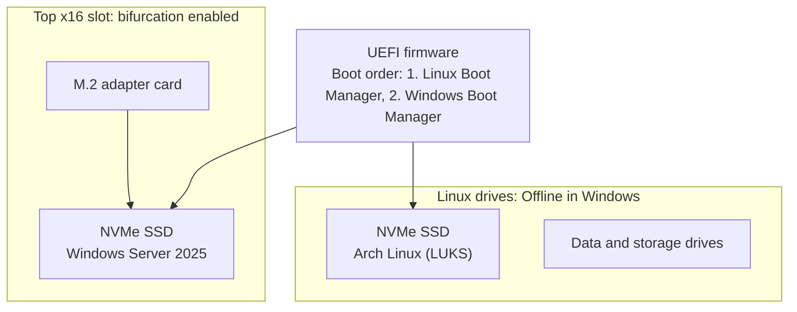
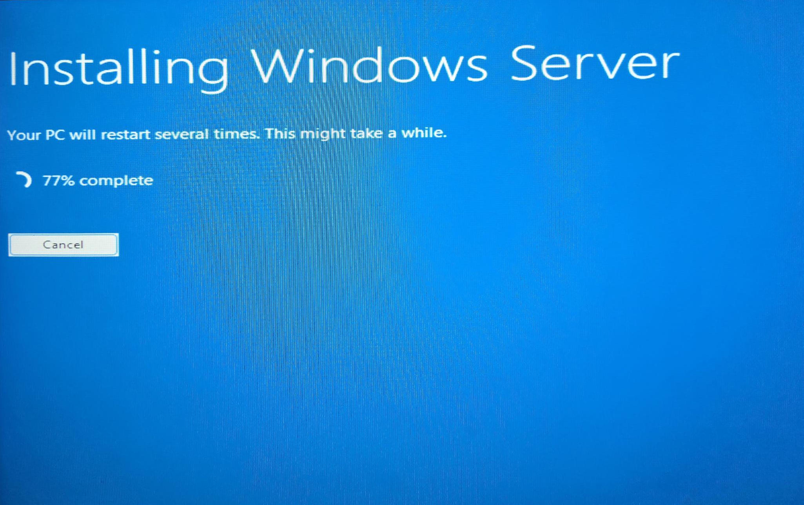
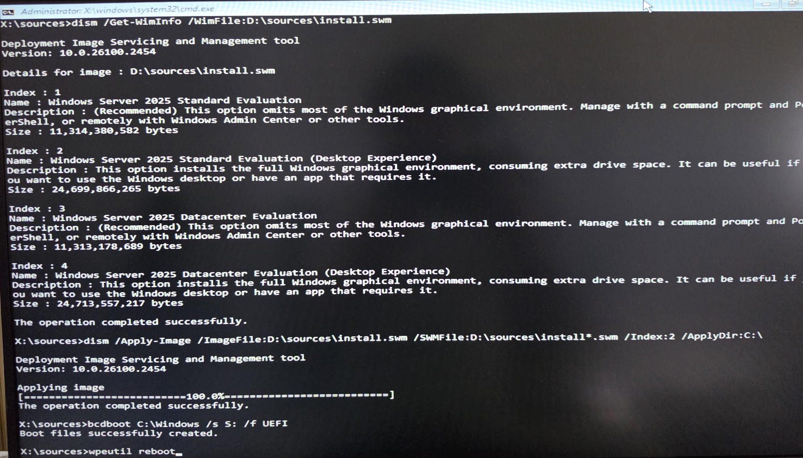
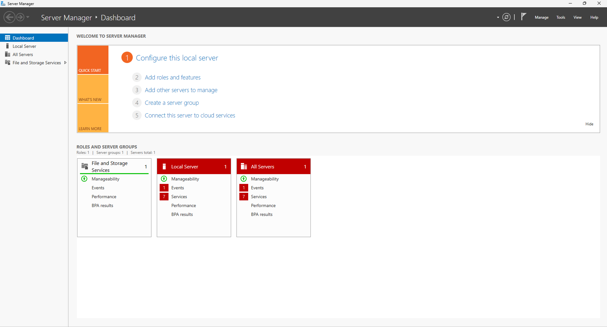
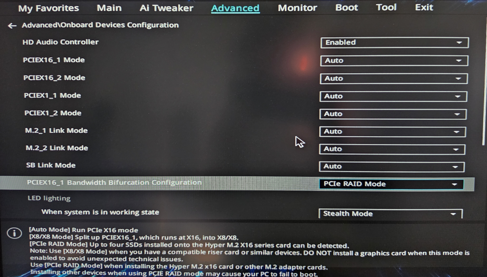
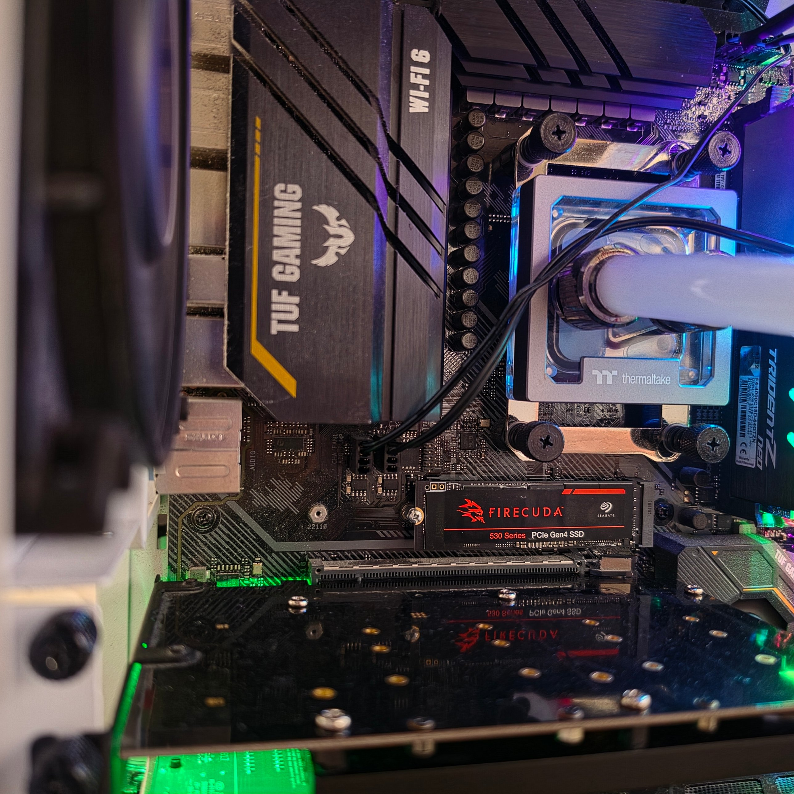

# windows-server-lab

## Overview

Windows Server 2025 installed on bare metal, dual-booting alongside an encrypted Arch Linux workstation.

The standard installer failed on this hardware at three different points. This repo documents how each failure was traced to its cause and fixed, ending in a manual deployment with DISM and bcdboot, followed by hardening that keeps Windows away from the Linux drives and turns off telemetry.

**What it proves:** hardware and firmware configuration, Windows deployment without the setup wizard, root-cause troubleshooting, and documentation of every step.

---
## Architecture



### Key settings

| Setting                                         | Value                                                         | Why                                                                                  |
| ----------------------------------------------- | ------------------------------------------------------------- | ------------------------------------------------------------------------------------ |
| `PCIEX16_1 Bandwidth Bifurcation Configuration` | **PCIe RAID Mode**                                            | The adapter card is passive. Without bifurcation, the board can't see the SSD on it. |
| `PCIEX16_1 Mode`                                | Auto                                                          | Left at default. Not the cause of any failure.                                       |
| Boot order                                      | Linux Boot Manager first                                      | Arch boots by default. Windows is reached through the F8 boot menu.                  |
| Windows disk state                              | All Linux drives **Offline**                                  | Windows can't read, write or initialize the Linux drives.                            |
| SAN policy                                      | **OfflineAll**                                                | Any disk Windows hasn't seen before also starts offline.                             |
| Telemetry                                       | Group Policy: diagnostic data **off**, DiagTrack **disabled** | Privacy. Verified in the registry and service state.                                 |

### Disk layout (Windows SSD)

|Partition|Size|Format|Letter during install|
|---|---|---|---|
|EFI System|512 MB|FAT32|`S:`|
|Windows|Remainder|NTFS (label `Windows`)|`C:`|

The EFI partition is 512 MB, above [Microsoft's current minimum](https://learn.microsoft.com/en-us/windows-hardware/manufacture/desktop/configure-uefigpt-based-hard-drive-partitions) (200 MB, or 300 MB on 4K-native drives), to leave room for boot files and recovery tools.

---
## Getting Started

How to reproduce this install. Read the [Incident](#incident) section first: it explains why the normal installer isn't used.

### Requirements

- Windows Server 2025 Evaluation ISO (free from Microsoft, 180-day evaluation)
- A USB drive, 16 GB or larger
- A Linux machine with `wimlib` installed (`sudo pacman -S wimlib` on Arch)

### 1. Verify the ISO's install image

```bash
sudo mkdir -p /mnt/iso
sudo mount -o loop,ro ~/Downloads/<server-2025-eval>.iso /mnt/iso
wimlib-imagex verify /mnt/iso/sources/install.wim
```

### 2. Build a FAT32 USB with a split install image

UEFI firmware boots FAT32 natively, but FAT32 can't hold a file over 4 GB, and `install.wim` is about 6.8 GB. The fix is to copy everything else, then split the image into chunks under 4 GB.

> **Check the device name first** with `lsblk`. The commands below erase the target drive. `/dev/sdX` is a placeholder.

```bash
# Wipe and partition the USB
sudo wipefs -a /dev/sdX
sudo parted /dev/sdX --script mklabel msdos mkpart primary fat32 1MiB 100% set 1 boot on
sudo mkfs.fat -F32 -n WINSERVER /dev/sdX1

# Mount the USB
sudo mkdir -p /mnt/usb
sudo mount /dev/sdX1 /mnt/usb

# Copy everything except the oversized install image
sudo rsync -r --info=progress2 --exclude='sources/install.wim' /mnt/iso/ /mnt/usb/

# Split install.wim into FAT32-safe pieces (3,800 MB each)
sudo wimlib-imagex split /mnt/iso/sources/install.wim /mnt/usb/sources/install.swm 3800

# Unmount
sudo umount /mnt/usb /mnt/iso
```

Result: `install.swm` (3.7 GB) and `install2.swm` (3.1 GB).

### 3. Boot the USB and open a command prompt

Boot from the USB in UEFI mode. At the first Windows Setup screen, press **Shift + F10** for a command prompt.

### 4. Take every non-target disk offline

This protects the other drives from anything that follows.

```
diskpart
list disk

select disk <target>
detail disk
offline disk
```

Repeat `select disk`, `detail disk` and `offline disk` for each drive that isn't the Windows target. `detail disk` shows the model, which confirms which drive you've selected.

### 5. Assign a letter to the EFI partition and format the Windows partition

```
select disk <target>
detail disk
list volume
select volume <EFI>
assign letter=S
list volume
exit

format C: /fs:ntfs /q /v:Windows
```

Volume ``<EFI>`` was the 512 MB FAT32 System partition on the target disk (Volume 2 on this machine). Find it with `list volume`; numbers vary.

### 6. Apply the image

```
dism /Get-WimInfo /WimFile:D:\sources\install.swm

dism /Apply-Image /ImageFile:D:\sources\install.swm /SWMFile:D:\sources\install*.swm /Index:2 /ApplyDir:C:\
```

- `D:` is the USB in this environment. Confirm with `list volume`.
- `/SWMFile:...install*.swm` tells DISM to read both split pieces.
- **Index 2** = Windows Server 2025 Standard Evaluation (Desktop Experience).

### 7. Write the boot files

```
bcdboot C:\Windows /s S: /f UEFI
```

Expected output: `Boot files successfully created.`

### 8. Reboot

```
wpeutil reboot
```

Windows finishes setup on first boot: region, license terms, then an Administrator password.

---
## Evidence

### Setup failing at 77%



### The fix: DISM and bcdboot



### Working server



### More screenshots





### Command output

**Image indexes on the split image** (`dism /Get-WimInfo`):

```
Index : 2
Name : Windows Server 2025 Standard Evaluation (Desktop Experience)
Size : 24,699,866,265 bytes
```

**Image applied and boot files written:**

```
Applying image
[==========================100.0%==========================]
The operation completed successfully.

X:\sources>bcdboot C:\Windows /s S: /f UEFI
Boot files successfully created.
```

**Telemetry policy** (`Get-ItemProperty "HKLM:\SOFTWARE\Policies\Microsoft\Windows\DataCollection"`):

```
AllowTelemetry : 0
```

**Telemetry service** (`Get-Service DiagTrack | Select-Object Status, StartType`):

```
Status  StartType
------  ---------
Stopped  Disabled
```

**SAN policy** (`diskpart` → `san`):

```
SAN Policy  : Offline All
```

---
## Incident

Four failures, from hardware to boot files. Each entry separates what was observed from what was inferred.

### 1. SSD not detected

| Item | Detail |
| --- | --- |
| **Symptom** | The Windows SSD on the adapter card didn't appear to the system. |
| **Setup at the time** | Adapter card in the bottom slot (PCIEX16_2), GPU in the top slot. |
| **Root cause** | The adapter is a passive M.2 card. It needs the slot split (bifurcated) into multiple links. The BIOS bifurcation setting on this board is for **PCIEX16_1**, the top slot. |
| **Fix** | Moved the card to PCIEX16_1 and the GPU to PCIEX16_2. Set `PCIEX16_1 Bandwidth Bifurcation Configuration` to **PCIe RAID Mode**. The BIOS help text describes this mode for "the Hyper M.2 x16 card or other M.2 adapter cards." |
| **Result** | SSD detected. |

### 2. Three USB install methods failed

| Method                          | Observed                                       | Cause                                                                                                                                                                                                         |
| ------------------------------- | ---------------------------------------------- | ------------------------------------------------------------------------------------------------------------------------------------------------------------------------------------------------------------- |
| **balenaEtcher**                | Windows Setup reported a missing media driver. | Etcher writes an ISO byte for byte. Windows ISOs aren't built to boot from USB that way, so Setup couldn't find its own installation media.                                                                   |
| **Ventoy**                      | Setup stopped at about 10%, twice.             | **Inferred:** Ventoy boots the ISO through its own layer, and the failure happened while Setup was reading from it. The PCIe slot mode was ruled out: it stayed on Auto for the install that later succeeded. |
| **Rufus** (NTFS with UEFI:NTFS) | `Load failure [3] Unsupported` at boot.        | Rufus puts the files on NTFS and adds a small UEFI:NTFS loader to bridge the firmware to it. That loader failed on this board's firmware.                                                                     |
| **Manual FAT32 + wimlib split** | Booted and ran.                                | UEFI firmware reads FAT32 natively, so no extra loader is needed. Splitting `install.wim` keeps every file under FAT32's 4 GB limit.                                                                          |
### 3. Partitioning the target drive

| Item | Detail |
| --- | --- |
| **Symptom** | Setup didn't create an EFI System partition on the target SSD, and then refused the Windows partition prepared for it. |
| **Fix** | Built the layout manually in diskpart, with a 512 MB EFI partition. Removed only the partition Setup rejected and let Setup use the unallocated space. |
| **Lesson** | With multiple drives present, take every non-target disk offline **before** partitioning, so Setup and diskpart can only see the target. |

### 4. Setup failed at 77%: `0x80073B92`

| Item | Detail |
| --- | --- |
| **Symptom** | Setup copied files to 77%, then failed. Error `0x80073B92`, logged as `BFSVC: Failed to get system partition`. |
| **What it means** | The image copy succeeded. The failure was at the next step, writing boot files, where Setup's boot-file service couldn't identify which partition was the EFI System partition. |
| **Root cause (inferred)** | With several drives in the machine and the target behind an adapter card, Setup couldn't resolve the System partition on its own. |
| **Fix** | Skipped the installer. Applied the image directly with `dism /Apply-Image`, then wrote the boot files with `bcdboot`, pointing it at the System partition explicitly (`/s S:`). |
| **Result** | `Boot files successfully created.` Windows booted and finished setup. |

**Why this works:** the graphical installer runs these same tools behind the scenes: partition, apply the image, write boot files. Running them by hand removes the step that was guessing. This is also how IT teams deploy Windows at scale.

---
## Runbook

### Booting

- **Arch Linux:** default. Power on and enter the LUKS passphrase.
- **Windows Server:** press **F8** at power-on and choose **Windows Boot Manager**.

### Keeping the Linux drives protected

Check after any hardware change or Windows update:

1. Right-click **Start** → **Disk Management**.
2. If Windows asks to **Initialize** a disk, click **Cancel**. Initializing would overwrite the Linux partition table.
3. Confirm every Linux drive shows **Offline**.

To confirm the SAN policy is still set:

```
diskpart
san
exit
```

Expected: `SAN Policy : Offline All`. To set it again:

```
diskpart
san policy=OfflineAll
exit
```

### Telemetry

Set once through Group Policy: `gpedit.msc` → **Computer Configuration** → **Administrative Templates** → **Windows Components** → **Data Collection and Preview Builds** → **Allow Diagnostic Data** → **Enabled**, with **Diagnostic data off**.

Apply and verify:

```powershell
gpupdate /force
Get-ItemProperty "HKLM:\SOFTWARE\Policies\Microsoft\Windows\DataCollection"
```

Expected: `AllowTelemetry : 0`.

Stop and disable the telemetry service, then verify:

```powershell
Stop-Service DiagTrack
Set-Service DiagTrack -StartupType Disabled
Get-Service DiagTrack | Select-Object Status, StartType
```

Expected: `Stopped` / `Disabled`.

### Evaluation license

The evaluation runs for 180 days and can be extended (rearmed) up to 6 times, about 3.4 years in total. Run these in an elevated PowerShell:

```powershell
# Days remaining and rearm count
slmgr /dlv

# Extend by another 180 days (reboot afterward)
slmgr /rearm
```

### Dual-boot clock

Linux keeps the hardware clock in UTC, and Windows treats it as local time. If either OS shows the wrong time after switching, align them.

---
## Notes

- Built with Claude (Anthropic) as an assistant throughout. Every command was run, and every result checked, on this hardware.